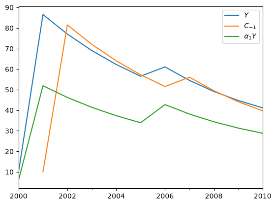

# SFCmodeler


<!-- WARNING: THIS FILE WAS AUTOGENERATED! DO NOT EDIT! -->

## Usage

### Installation

``` sh
$ pip install SFCmodeler
```

(Doesn’t work yet :)

Install latest from the GitHub [repository](https://github.com/slevey087/SFCmodeler):

``` sh
$ pip install git+https://github.com/slevey087/SFCmodeler.git
```

Then import with

``` py
from SFCmodeler import *
```

### Documentation

Documentation can be found hosted on this GitHub [repository](https://github.com/slevey087/SFCmodeler)’s [pages](https://slevey087.github.io/SFCmodeler/). Additionally you can find package manager specific guidelines on [pypi](https://pypi.org/project/SFCmodeler/).

## How to use

First declare [`Parameter`](https://slevey087.github.io/SFCmodeler/term.html#parameter)s (fixed exogenous values), [`Variable`](https://slevey087.github.io/SFCmodeler/term.html#variable)s (found endogenously by the solver), and any [`Random`](https://slevey087.github.io/SFCmodeler/term.html#random) elements, each with a `name` and optional `description` and `initial_value`

``` python
Variable.default_value = 10  # This sets a default initial value for Variables

C = Variable("C","Consumption")
T = Variable("T","Taxes")
V = Variable("V","Wealth",100)   # The number 100 overrides the default value declared above
Y = Variable("Y","GDP")

alpha1 = Parameter("alpha_1","MPC out of income",0.6)
alpha2 = Parameter("alpha_2","MPC out of wealth",0.4)
G = Parameter("G","Government spending",5)
theta = Parameter("theta","Tax rate",0.2)
```

Next define the [`SFCmodel`](https://slevey087.github.io/SFCmodeler/modeler.html#sfcmodel) with a list of equations. Each equation should have one variable on the LHS, then `<<` as the equals sign, then any valid `Sympy` expression:

``` python
model = SFCmodel(
    [
        C << alpha1 * (Y - T) + alpha2 * V(-1),
        Y << C + G,
        T << theta * Y,
        V << V(-1) + Y - T - C
    ]
)
```

Run `.solve()` to solve one period forward, or specify a number of periods to solve more than one time step:

``` python
model.solve(5)
```

      0%|          | 0/5 [00:00<?, ?it/s]

|  | $C$ | $G$ | $T$ | $V$ | $V_{-1}$ | $Y$ | $\alpha_{1}$ | $\alpha_{2}$ | $\theta$ |
|:---|---:|---:|---:|---:|---:|---:|---:|---:|---:|
| 2000 | 10 | 5 | 10 | 100 | 100 | 10 | 0.6 | 0.4 | 0.2 |
| 2001 | 81.5385 | 5 | 17.3077 | 87.6923 | 100 | 86.5385 | 0.6 | 0.4 | 0.2 |
| 2002 | 72.071 | 5 | 15.4142 | 77.2781 | 87.6923 | 77.071 | 0.6 | 0.4 | 0.2 |
| 2003 | 64.0601 | 5 | 13.812 | 68.4661 | 77.2781 | 69.0601 | 0.6 | 0.4 | 0.2 |
| 2004 | 57.2816 | 5 | 12.4563 | 61.0098 | 68.4661 | 62.2816 | 0.6 | 0.4 | 0.2 |
| 2005 | 51.546 | 5 | 11.3092 | 54.7006 | 61.0098 | 56.546 | 0.6 | 0.4 | 0.2 |

Easily shock a model by changing a parameter value with this shortcut:

``` python
model[alpha1] = 0.7

model.solve(5)
```

      0%|          | 0/5 [00:00<?, ?it/s]

|  | $C$ | $G$ | $T$ | $V$ | $V_{-1}$ | $Y$ | $\alpha_{1}$ | $\alpha_{2}$ | $\theta$ |
|:---|---:|---:|---:|---:|---:|---:|---:|---:|---:|
| 2000 | 10 | 5 | 10 | 100 | 100 | 10 | 0.6 | 0.4 | 0.2 |
| 2001 | 81.5385 | 5 | 17.3077 | 87.6923 | 100 | 86.5385 | 0.6 | 0.4 | 0.2 |
| 2002 | 72.071 | 5 | 15.4142 | 77.2781 | 87.6923 | 77.071 | 0.6 | 0.4 | 0.2 |
| 2003 | 64.0601 | 5 | 13.812 | 68.4661 | 77.2781 | 69.0601 | 0.6 | 0.4 | 0.2 |
| 2004 | 57.2816 | 5 | 12.4563 | 61.0098 | 68.4661 | 62.2816 | 0.6 | 0.4 | 0.2 |
| 2005 | 51.546 | 5 | 11.3092 | 54.7006 | 61.0098 | 56.546 | 0.6 | 0.4 | 0.2 |
| 2006 | 56.0914 | 5 | 12.2183 | 47.4823 | 54.7006 | 61.0914 | 0.7 | 0.4 | 0.2 |
| 2007 | 49.5294 | 5 | 10.9059 | 41.5764 | 47.4823 | 54.5294 | 0.7 | 0.4 | 0.2 |
| 2008 | 44.1604 | 5 | 9.83208 | 36.7443 | 41.5764 | 49.1604 | 0.7 | 0.4 | 0.2 |
| 2009 | 39.7676 | 5 | 8.95352 | 32.7908 | 36.7443 | 44.7676 | 0.7 | 0.4 | 0.2 |
| 2010 | 36.1735 | 5 | 8.2347 | 29.5561 | 32.7908 | 41.1735 | 0.7 | 0.4 | 0.2 |

`.data` holds a [`ModelResults`](https://slevey087.github.io/SFCmodeler/modelresults.html#modelresults) object, which is a fancy pandas `DataFrame` such that you can use your parameters and variables as indexers, or also calculated expressions, and also quickly plot:

``` python
model.data[[Y, C(-1), alpha1*Y]]
```

|      |     $Y$ | $C_{-1}$ | $\alpha_{1} Y$ |
|:-----|--------:|---------:|---------------:|
| 2000 |      10 |      nan |              6 |
| 2001 | 86.5385 |       10 |        51.9231 |
| 2002 |  77.071 |  81.5385 |        46.2426 |
| 2003 | 69.0601 |   72.071 |         41.436 |
| 2004 | 62.2816 |  64.0601 |         37.369 |
| 2005 |  56.546 |  57.2816 |        33.9276 |
| 2006 | 61.0914 |   51.546 |         42.764 |
| 2007 | 54.5294 |  56.0914 |        38.1705 |
| 2008 | 49.1604 |  49.5294 |        34.4123 |
| 2009 | 44.7676 |  44.1604 |        31.3373 |
| 2010 | 41.1735 |  39.7676 |        28.8214 |

``` python
model.data[[Y, C(-1), alpha1*Y]].plot()
```



See the other doc pages for more details and additional features.
