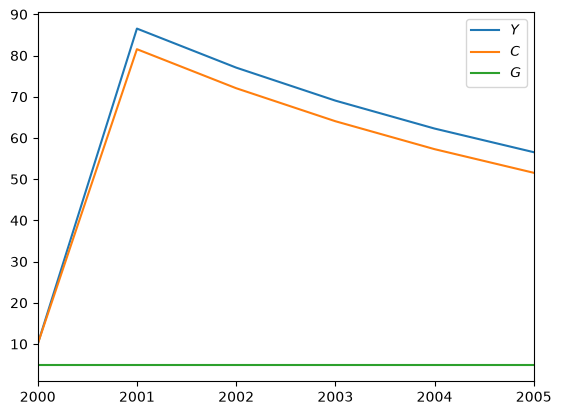
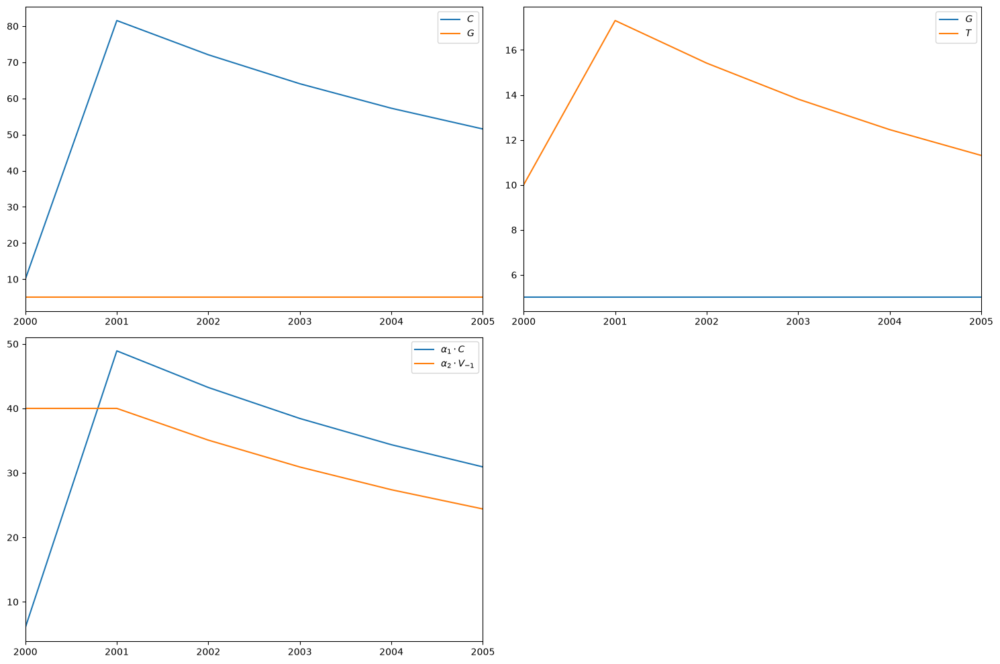

# ModelResults


<!-- WARNING: THIS FILE WAS AUTOGENERATED! DO NOT EDIT! -->

------------------------------------------------------------------------

<a
href="https://github.com/slevey087/SFCmodeler/blob/main/SFCmodeler/modelresults.py#L16"
target="_blank" style="float:right; font-size:smaller">source</a>

### ModelResults

``` python
def ModelResults(
    results, index:NoneType=None, start_period:str='2000', freq:str='Y', reindex:bool=False, debuglist:bool=False
):
```

[`ModelResults`](https://slevey087.github.io/SFCmodeler/modelresults.html#modelresults)
is a small wrapper around a standard pandas `DataFrame`, that just adds
some nicer indexing, slicing, and plotting.

You won’t usually create one yourself, and instead an
[`SFCmodel`](https://slevey087.github.io/SFCmodeler/modeler.html#sfcmodel)
will store one in the `.data` property:

``` python
Variable.default_value = 10

C = Variable("C","Consumption")
T = Variable("T","Taxes")
V = Variable("V","Wealth",100)
Y = Variable("Y","GDP")

alpha1 = Parameter("alpha_1","MPC out of income",0.6)
alpha2 = Parameter("alpha_2","MPC out of wealth",0.4)
G = Parameter("G","Government spending",5)
theta = Parameter("theta","Tax rate",0.2)

model = SFCmodel(
    [
        C << alpha1 * (Y - T) + alpha2 * V(-1),
        Y << C + G,
        T << theta * Y,
        V << V(-1) + Y - T - C
    ]
)

model.solve(5)

model.data
```

      0%|          | 0/5 [00:00<?, ?it/s]

<table style="width:100%;">
<colgroup>
<col style="width: 5%" />
<col style="width: 8%" />
<col style="width: 6%" />
<col style="width: 8%" />
<col style="width: 9%" />
<col style="width: 11%" />
<col style="width: 8%" />
<col style="width: 15%" />
<col style="width: 15%" />
<col style="width: 11%" />
</colgroup>
<thead>
<tr>
<th style="text-align: left;"></th>
<th style="text-align: right;"><span
class="math inline"><em>C</em></span></th>
<th style="text-align: right;"><span
class="math inline"><em>G</em></span></th>
<th style="text-align: right;"><span
class="math inline"><em>T</em></span></th>
<th style="text-align: right;"><span
class="math inline"><em>V</em></span></th>
<th style="text-align: right;"><span
class="math inline"><em>V</em><sub>−1</sub></span></th>
<th style="text-align: right;"><span
class="math inline"><em>Y</em></span></th>
<th style="text-align: right;"><span
class="math inline"><em>α</em><sub>1</sub></span></th>
<th style="text-align: right;"><span
class="math inline"><em>α</em><sub>2</sub></span></th>
<th style="text-align: right;"><span
class="math inline"><em>θ</em></span></th>
</tr>
</thead>
<tbody>
<tr>
<td style="text-align: left;">2000</td>
<td style="text-align: right;">10</td>
<td style="text-align: right;">5</td>
<td style="text-align: right;">10</td>
<td style="text-align: right;">100</td>
<td style="text-align: right;">100</td>
<td style="text-align: right;">10</td>
<td style="text-align: right;">0.6</td>
<td style="text-align: right;">0.4</td>
<td style="text-align: right;">0.2</td>
</tr>
<tr>
<td style="text-align: left;">2001</td>
<td style="text-align: right;">81.5385</td>
<td style="text-align: right;">5</td>
<td style="text-align: right;">17.3077</td>
<td style="text-align: right;">87.6923</td>
<td style="text-align: right;">100</td>
<td style="text-align: right;">86.5385</td>
<td style="text-align: right;">0.6</td>
<td style="text-align: right;">0.4</td>
<td style="text-align: right;">0.2</td>
</tr>
<tr>
<td style="text-align: left;">2002</td>
<td style="text-align: right;">72.071</td>
<td style="text-align: right;">5</td>
<td style="text-align: right;">15.4142</td>
<td style="text-align: right;">77.2781</td>
<td style="text-align: right;">87.6923</td>
<td style="text-align: right;">77.071</td>
<td style="text-align: right;">0.6</td>
<td style="text-align: right;">0.4</td>
<td style="text-align: right;">0.2</td>
</tr>
<tr>
<td style="text-align: left;">2003</td>
<td style="text-align: right;">64.0601</td>
<td style="text-align: right;">5</td>
<td style="text-align: right;">13.812</td>
<td style="text-align: right;">68.4661</td>
<td style="text-align: right;">77.2781</td>
<td style="text-align: right;">69.0601</td>
<td style="text-align: right;">0.6</td>
<td style="text-align: right;">0.4</td>
<td style="text-align: right;">0.2</td>
</tr>
<tr>
<td style="text-align: left;">2004</td>
<td style="text-align: right;">57.2816</td>
<td style="text-align: right;">5</td>
<td style="text-align: right;">12.4563</td>
<td style="text-align: right;">61.0098</td>
<td style="text-align: right;">68.4661</td>
<td style="text-align: right;">62.2816</td>
<td style="text-align: right;">0.6</td>
<td style="text-align: right;">0.4</td>
<td style="text-align: right;">0.2</td>
</tr>
<tr>
<td style="text-align: left;">2005</td>
<td style="text-align: right;">51.546</td>
<td style="text-align: right;">5</td>
<td style="text-align: right;">11.3092</td>
<td style="text-align: right;">54.7006</td>
<td style="text-align: right;">61.0098</td>
<td style="text-align: right;">56.546</td>
<td style="text-align: right;">0.6</td>
<td style="text-align: right;">0.4</td>
<td style="text-align: right;">0.2</td>
</tr>
</tbody>
</table>

Note that the column headers display with rendered LaTeX in Jupyter
notebooks or Google Colab. You should use the
[`Variable`](https://slevey087.github.io/SFCmodeler/term.html#variable)s
and
[`Parameter`](https://slevey087.github.io/SFCmodeler/term.html#parameter)s
from your model equations to index:

``` python
model.data[Y]
```

<table>
<thead>
<tr>
<th style="text-align: left;"></th>
<th style="text-align: right;"><span
class="math inline"><em>Y</em></span></th>
</tr>
</thead>
<tbody>
<tr>
<td style="text-align: left;">2000</td>
<td style="text-align: right;">10</td>
</tr>
<tr>
<td style="text-align: left;">2001</td>
<td style="text-align: right;">86.5385</td>
</tr>
<tr>
<td style="text-align: left;">2002</td>
<td style="text-align: right;">77.071</td>
</tr>
<tr>
<td style="text-align: left;">2003</td>
<td style="text-align: right;">69.0601</td>
</tr>
<tr>
<td style="text-align: left;">2004</td>
<td style="text-align: right;">62.2816</td>
</tr>
<tr>
<td style="text-align: left;">2005</td>
<td style="text-align: right;">56.546</td>
</tr>
</tbody>
</table>

``` python
model.data[alpha1]
```

<table>
<thead>
<tr>
<th style="text-align: left;"></th>
<th style="text-align: right;"><span
class="math inline"><em>α</em><sub>1</sub></span></th>
</tr>
</thead>
<tbody>
<tr>
<td style="text-align: left;">2000</td>
<td style="text-align: right;">0.6</td>
</tr>
<tr>
<td style="text-align: left;">2001</td>
<td style="text-align: right;">0.6</td>
</tr>
<tr>
<td style="text-align: left;">2002</td>
<td style="text-align: right;">0.6</td>
</tr>
<tr>
<td style="text-align: left;">2003</td>
<td style="text-align: right;">0.6</td>
</tr>
<tr>
<td style="text-align: left;">2004</td>
<td style="text-align: right;">0.6</td>
</tr>
<tr>
<td style="text-align: left;">2005</td>
<td style="text-align: right;">0.6</td>
</tr>
</tbody>
</table>

As well as lists:

``` python
model.data[[Y, alpha1]]
```

<table>
<thead>
<tr>
<th style="text-align: left;"></th>
<th style="text-align: right;"><span
class="math inline"><em>Y</em></span></th>
<th style="text-align: right;"><span
class="math inline"><em>α</em><sub>1</sub></span></th>
</tr>
</thead>
<tbody>
<tr>
<td style="text-align: left;">2000</td>
<td style="text-align: right;">10</td>
<td style="text-align: right;">0.6</td>
</tr>
<tr>
<td style="text-align: left;">2001</td>
<td style="text-align: right;">86.5385</td>
<td style="text-align: right;">0.6</td>
</tr>
<tr>
<td style="text-align: left;">2002</td>
<td style="text-align: right;">77.071</td>
<td style="text-align: right;">0.6</td>
</tr>
<tr>
<td style="text-align: left;">2003</td>
<td style="text-align: right;">69.0601</td>
<td style="text-align: right;">0.6</td>
</tr>
<tr>
<td style="text-align: left;">2004</td>
<td style="text-align: right;">62.2816</td>
<td style="text-align: right;">0.6</td>
</tr>
<tr>
<td style="text-align: left;">2005</td>
<td style="text-align: right;">56.546</td>
<td style="text-align: right;">0.6</td>
</tr>
</tbody>
</table>

You can also do a custom calculation using a formula for the index (with
any valid `Sympy` expression):

``` python
model.data[C+G]
```

<table>
<thead>
<tr>
<th style="text-align: left;"></th>
<th style="text-align: right;"><span
class="math inline"><em>G</em> + <em>C</em></span></th>
</tr>
</thead>
<tbody>
<tr>
<td style="text-align: left;">2000</td>
<td style="text-align: right;">15</td>
</tr>
<tr>
<td style="text-align: left;">2001</td>
<td style="text-align: right;">86.5385</td>
</tr>
<tr>
<td style="text-align: left;">2002</td>
<td style="text-align: right;">77.071</td>
</tr>
<tr>
<td style="text-align: left;">2003</td>
<td style="text-align: right;">69.0601</td>
</tr>
<tr>
<td style="text-align: left;">2004</td>
<td style="text-align: right;">62.2816</td>
</tr>
<tr>
<td style="text-align: left;">2005</td>
<td style="text-align: right;">56.546</td>
</tr>
</tbody>
</table>

Including lags:

``` python
model.data[[Y,Y(-1)]]
```

<table>
<thead>
<tr>
<th style="text-align: left;"></th>
<th style="text-align: right;"><span
class="math inline"><em>Y</em></span></th>
<th style="text-align: right;"><span
class="math inline"><em>Y</em><sub>−1</sub></span></th>
</tr>
</thead>
<tbody>
<tr>
<td style="text-align: left;">2000</td>
<td style="text-align: right;">10</td>
<td style="text-align: right;">nan</td>
</tr>
<tr>
<td style="text-align: left;">2001</td>
<td style="text-align: right;">86.5385</td>
<td style="text-align: right;">10</td>
</tr>
<tr>
<td style="text-align: left;">2002</td>
<td style="text-align: right;">77.071</td>
<td style="text-align: right;">86.5385</td>
</tr>
<tr>
<td style="text-align: left;">2003</td>
<td style="text-align: right;">69.0601</td>
<td style="text-align: right;">77.071</td>
</tr>
<tr>
<td style="text-align: left;">2004</td>
<td style="text-align: right;">62.2816</td>
<td style="text-align: right;">69.0601</td>
</tr>
<tr>
<td style="text-align: left;">2005</td>
<td style="text-align: right;">56.546</td>
<td style="text-align: right;">62.2816</td>
</tr>
</tbody>
</table>

That’s for viewing columns. To index by specific rows, you can use
either the row number or the period name:

``` python
model.data["2002"]
```

<table style="width:100%;">
<colgroup>
<col style="width: 5%" />
<col style="width: 7%" />
<col style="width: 6%" />
<col style="width: 8%" />
<col style="width: 8%" />
<col style="width: 11%" />
<col style="width: 7%" />
<col style="width: 15%" />
<col style="width: 15%" />
<col style="width: 11%" />
</colgroup>
<thead>
<tr>
<th style="text-align: left;"></th>
<th style="text-align: right;"><span
class="math inline"><em>C</em></span></th>
<th style="text-align: right;"><span
class="math inline"><em>G</em></span></th>
<th style="text-align: right;"><span
class="math inline"><em>T</em></span></th>
<th style="text-align: right;"><span
class="math inline"><em>V</em></span></th>
<th style="text-align: right;"><span
class="math inline"><em>V</em><sub>−1</sub></span></th>
<th style="text-align: right;"><span
class="math inline"><em>Y</em></span></th>
<th style="text-align: right;"><span
class="math inline"><em>α</em><sub>1</sub></span></th>
<th style="text-align: right;"><span
class="math inline"><em>α</em><sub>2</sub></span></th>
<th style="text-align: right;"><span
class="math inline"><em>θ</em></span></th>
</tr>
</thead>
<tbody>
<tr>
<td style="text-align: left;">2002</td>
<td style="text-align: right;">72.071</td>
<td style="text-align: right;">5</td>
<td style="text-align: right;">15.4142</td>
<td style="text-align: right;">77.2781</td>
<td style="text-align: right;">87.6923</td>
<td style="text-align: right;">77.071</td>
<td style="text-align: right;">0.6</td>
<td style="text-align: right;">0.4</td>
<td style="text-align: right;">0.2</td>
</tr>
</tbody>
</table>

``` python
model.data["2002":"2004"]
```

<table>
<colgroup>
<col style="width: 5%" />
<col style="width: 8%" />
<col style="width: 6%" />
<col style="width: 8%" />
<col style="width: 8%" />
<col style="width: 11%" />
<col style="width: 8%" />
<col style="width: 15%" />
<col style="width: 15%" />
<col style="width: 11%" />
</colgroup>
<thead>
<tr>
<th style="text-align: left;"></th>
<th style="text-align: right;"><span
class="math inline"><em>C</em></span></th>
<th style="text-align: right;"><span
class="math inline"><em>G</em></span></th>
<th style="text-align: right;"><span
class="math inline"><em>T</em></span></th>
<th style="text-align: right;"><span
class="math inline"><em>V</em></span></th>
<th style="text-align: right;"><span
class="math inline"><em>V</em><sub>−1</sub></span></th>
<th style="text-align: right;"><span
class="math inline"><em>Y</em></span></th>
<th style="text-align: right;"><span
class="math inline"><em>α</em><sub>1</sub></span></th>
<th style="text-align: right;"><span
class="math inline"><em>α</em><sub>2</sub></span></th>
<th style="text-align: right;"><span
class="math inline"><em>θ</em></span></th>
</tr>
</thead>
<tbody>
<tr>
<td style="text-align: left;">2002</td>
<td style="text-align: right;">72.071</td>
<td style="text-align: right;">5</td>
<td style="text-align: right;">15.4142</td>
<td style="text-align: right;">77.2781</td>
<td style="text-align: right;">87.6923</td>
<td style="text-align: right;">77.071</td>
<td style="text-align: right;">0.6</td>
<td style="text-align: right;">0.4</td>
<td style="text-align: right;">0.2</td>
</tr>
<tr>
<td style="text-align: left;">2003</td>
<td style="text-align: right;">64.0601</td>
<td style="text-align: right;">5</td>
<td style="text-align: right;">13.812</td>
<td style="text-align: right;">68.4661</td>
<td style="text-align: right;">77.2781</td>
<td style="text-align: right;">69.0601</td>
<td style="text-align: right;">0.6</td>
<td style="text-align: right;">0.4</td>
<td style="text-align: right;">0.2</td>
</tr>
<tr>
<td style="text-align: left;">2004</td>
<td style="text-align: right;">57.2816</td>
<td style="text-align: right;">5</td>
<td style="text-align: right;">12.4563</td>
<td style="text-align: right;">61.0098</td>
<td style="text-align: right;">68.4661</td>
<td style="text-align: right;">62.2816</td>
<td style="text-align: right;">0.6</td>
<td style="text-align: right;">0.4</td>
<td style="text-align: right;">0.2</td>
</tr>
</tbody>
</table>

``` python
model.data[2]
```

<table style="width:100%;">
<colgroup>
<col style="width: 5%" />
<col style="width: 7%" />
<col style="width: 6%" />
<col style="width: 8%" />
<col style="width: 8%" />
<col style="width: 11%" />
<col style="width: 7%" />
<col style="width: 15%" />
<col style="width: 15%" />
<col style="width: 11%" />
</colgroup>
<thead>
<tr>
<th style="text-align: left;"></th>
<th style="text-align: right;"><span
class="math inline"><em>C</em></span></th>
<th style="text-align: right;"><span
class="math inline"><em>G</em></span></th>
<th style="text-align: right;"><span
class="math inline"><em>T</em></span></th>
<th style="text-align: right;"><span
class="math inline"><em>V</em></span></th>
<th style="text-align: right;"><span
class="math inline"><em>V</em><sub>−1</sub></span></th>
<th style="text-align: right;"><span
class="math inline"><em>Y</em></span></th>
<th style="text-align: right;"><span
class="math inline"><em>α</em><sub>1</sub></span></th>
<th style="text-align: right;"><span
class="math inline"><em>α</em><sub>2</sub></span></th>
<th style="text-align: right;"><span
class="math inline"><em>θ</em></span></th>
</tr>
</thead>
<tbody>
<tr>
<td style="text-align: left;">2002</td>
<td style="text-align: right;">72.071</td>
<td style="text-align: right;">5</td>
<td style="text-align: right;">15.4142</td>
<td style="text-align: right;">77.2781</td>
<td style="text-align: right;">87.6923</td>
<td style="text-align: right;">77.071</td>
<td style="text-align: right;">0.6</td>
<td style="text-align: right;">0.4</td>
<td style="text-align: right;">0.2</td>
</tr>
</tbody>
</table>

``` python
model.data[2:4]
```

<table>
<colgroup>
<col style="width: 5%" />
<col style="width: 8%" />
<col style="width: 6%" />
<col style="width: 8%" />
<col style="width: 8%" />
<col style="width: 11%" />
<col style="width: 8%" />
<col style="width: 15%" />
<col style="width: 15%" />
<col style="width: 11%" />
</colgroup>
<thead>
<tr>
<th style="text-align: left;"></th>
<th style="text-align: right;"><span
class="math inline"><em>C</em></span></th>
<th style="text-align: right;"><span
class="math inline"><em>G</em></span></th>
<th style="text-align: right;"><span
class="math inline"><em>T</em></span></th>
<th style="text-align: right;"><span
class="math inline"><em>V</em></span></th>
<th style="text-align: right;"><span
class="math inline"><em>V</em><sub>−1</sub></span></th>
<th style="text-align: right;"><span
class="math inline"><em>Y</em></span></th>
<th style="text-align: right;"><span
class="math inline"><em>α</em><sub>1</sub></span></th>
<th style="text-align: right;"><span
class="math inline"><em>α</em><sub>2</sub></span></th>
<th style="text-align: right;"><span
class="math inline"><em>θ</em></span></th>
</tr>
</thead>
<tbody>
<tr>
<td style="text-align: left;">2002</td>
<td style="text-align: right;">72.071</td>
<td style="text-align: right;">5</td>
<td style="text-align: right;">15.4142</td>
<td style="text-align: right;">77.2781</td>
<td style="text-align: right;">87.6923</td>
<td style="text-align: right;">77.071</td>
<td style="text-align: right;">0.6</td>
<td style="text-align: right;">0.4</td>
<td style="text-align: right;">0.2</td>
</tr>
<tr>
<td style="text-align: left;">2003</td>
<td style="text-align: right;">64.0601</td>
<td style="text-align: right;">5</td>
<td style="text-align: right;">13.812</td>
<td style="text-align: right;">68.4661</td>
<td style="text-align: right;">77.2781</td>
<td style="text-align: right;">69.0601</td>
<td style="text-align: right;">0.6</td>
<td style="text-align: right;">0.4</td>
<td style="text-align: right;">0.2</td>
</tr>
</tbody>
</table>

And of course you can do both columns and rows:

``` python
model.data[[Y,C(-1),alpha1*Y]][2:4]
```

<table>
<thead>
<tr>
<th style="text-align: left;"></th>
<th style="text-align: right;"><span
class="math inline"><em>Y</em></span></th>
<th style="text-align: right;"><span
class="math inline"><em>C</em><sub>−1</sub></span></th>
<th style="text-align: right;"><span
class="math inline"><em>α</em><sub>1</sub> ⋅ <em>Y</em></span></th>
</tr>
</thead>
<tbody>
<tr>
<td style="text-align: left;">2002</td>
<td style="text-align: right;">77.071</td>
<td style="text-align: right;">81.5385</td>
<td style="text-align: right;">46.2426</td>
</tr>
<tr>
<td style="text-align: left;">2003</td>
<td style="text-align: right;">69.0601</td>
<td style="text-align: right;">72.071</td>
<td style="text-align: right;">41.436</td>
</tr>
</tbody>
</table>

The other thing that
[`ModelResults`](https://slevey087.github.io/SFCmodeler/modelresults.html#modelresults)
can simplify for you is plotting. Often all you need to do is index to
the data you want using the methods above, then call `.plot()`:

``` python
model.data[[Y,C,G]].plot()
```



`.plot()` primarily just forwards to the underlying `df.plot`, and
passes along any `kwargs`. However, you can also call `plot` with a list
of lists, in order to quickly build one figure with multiple subplots:

``` python
model.data.plot([
    [C,G],
    [G,T],
    [alpha1*C,alpha2*V(-1)],
])
```



Note that you can do calculations and lags here too. Also, any `kwargs`
passed to `plot` in this mode will be distributed to every sub-axes.

Finally,
[`ModelResults`](https://slevey087.github.io/SFCmodeler/modelresults.html#modelresults)
really is just a thin wrapper over the `DataFrame`. If you should need
to get it directly, you can do `.df`:

``` python
model.data.df
```

<div>
<style scoped>
    .dataframe tbody tr th:only-of-type {
        vertical-align: middle;
    }
&#10;    .dataframe tbody tr th {
        vertical-align: top;
    }
&#10;    .dataframe thead th {
        text-align: right;
    }
</style>

<table class="dataframe" data-quarto-postprocess="true" data-border="1">
<thead>
<tr style="text-align: right;">
<th data-quarto-table-cell-role="th"></th>
<th data-quarto-table-cell-role="th">C</th>
<th data-quarto-table-cell-role="th">G</th>
<th data-quarto-table-cell-role="th">T</th>
<th data-quarto-table-cell-role="th">V</th>
<th data-quarto-table-cell-role="th">V_{-1}</th>
<th data-quarto-table-cell-role="th">Y</th>
<th data-quarto-table-cell-role="th">alpha_1</th>
<th data-quarto-table-cell-role="th">alpha_2</th>
<th data-quarto-table-cell-role="th">theta</th>
</tr>
</thead>
<tbody>
<tr>
<td data-quarto-table-cell-role="th">2000</td>
<td>10.000000</td>
<td>5.0</td>
<td>10.000000</td>
<td>100.000000</td>
<td>100.000000</td>
<td>10.000000</td>
<td>0.6</td>
<td>0.4</td>
<td>0.2</td>
</tr>
<tr>
<td data-quarto-table-cell-role="th">2001</td>
<td>81.538462</td>
<td>5.0</td>
<td>17.307692</td>
<td>87.692308</td>
<td>100.000000</td>
<td>86.538462</td>
<td>0.6</td>
<td>0.4</td>
<td>0.2</td>
</tr>
<tr>
<td data-quarto-table-cell-role="th">2002</td>
<td>72.071006</td>
<td>5.0</td>
<td>15.414201</td>
<td>77.278107</td>
<td>87.692308</td>
<td>77.071006</td>
<td>0.6</td>
<td>0.4</td>
<td>0.2</td>
</tr>
<tr>
<td data-quarto-table-cell-role="th">2003</td>
<td>64.060082</td>
<td>5.0</td>
<td>13.812016</td>
<td>68.466090</td>
<td>77.278107</td>
<td>69.060082</td>
<td>0.6</td>
<td>0.4</td>
<td>0.2</td>
</tr>
<tr>
<td data-quarto-table-cell-role="th">2004</td>
<td>57.281608</td>
<td>5.0</td>
<td>12.456322</td>
<td>61.009769</td>
<td>68.466090</td>
<td>62.281608</td>
<td>0.6</td>
<td>0.4</td>
<td>0.2</td>
</tr>
<tr>
<td data-quarto-table-cell-role="th">2005</td>
<td>51.545976</td>
<td>5.0</td>
<td>11.309195</td>
<td>54.700573</td>
<td>61.009769</td>
<td>56.545976</td>
<td>0.6</td>
<td>0.4</td>
<td>0.2</td>
</tr>
</tbody>
</table>

</div>

But, any function calls not mentioned above on the
[`ModelResults`](https://slevey087.github.io/SFCmodeler/modelresults.html#modelresults)
object will get forwarded to the underlying dataframe, e.g.

``` python
model.data.pct_change()
```

<div>
<style scoped>
    .dataframe tbody tr th:only-of-type {
        vertical-align: middle;
    }
&#10;    .dataframe tbody tr th {
        vertical-align: top;
    }
&#10;    .dataframe thead th {
        text-align: right;
    }
</style>

<table class="dataframe" data-quarto-postprocess="true" data-border="1">
<thead>
<tr style="text-align: right;">
<th data-quarto-table-cell-role="th"></th>
<th data-quarto-table-cell-role="th">C</th>
<th data-quarto-table-cell-role="th">G</th>
<th data-quarto-table-cell-role="th">T</th>
<th data-quarto-table-cell-role="th">V</th>
<th data-quarto-table-cell-role="th">V_{-1}</th>
<th data-quarto-table-cell-role="th">Y</th>
<th data-quarto-table-cell-role="th">alpha_1</th>
<th data-quarto-table-cell-role="th">alpha_2</th>
<th data-quarto-table-cell-role="th">theta</th>
</tr>
</thead>
<tbody>
<tr>
<td data-quarto-table-cell-role="th">2000</td>
<td>NaN</td>
<td>NaN</td>
<td>NaN</td>
<td>NaN</td>
<td>NaN</td>
<td>NaN</td>
<td>NaN</td>
<td>NaN</td>
<td>NaN</td>
</tr>
<tr>
<td data-quarto-table-cell-role="th">2001</td>
<td>7.153846</td>
<td>0.0</td>
<td>0.730769</td>
<td>-0.123077</td>
<td>0.000000</td>
<td>7.653846</td>
<td>0.0</td>
<td>0.0</td>
<td>0.0</td>
</tr>
<tr>
<td data-quarto-table-cell-role="th">2002</td>
<td>-0.116110</td>
<td>0.0</td>
<td>-0.109402</td>
<td>-0.118758</td>
<td>-0.123077</td>
<td>-0.109402</td>
<td>0.0</td>
<td>0.0</td>
<td>0.0</td>
</tr>
<tr>
<td data-quarto-table-cell-role="th">2003</td>
<td>-0.111153</td>
<td>0.0</td>
<td>-0.103942</td>
<td>-0.114030</td>
<td>-0.118758</td>
<td>-0.103942</td>
<td>0.0</td>
<td>0.0</td>
<td>0.0</td>
</tr>
<tr>
<td data-quarto-table-cell-role="th">2004</td>
<td>-0.105814</td>
<td>0.0</td>
<td>-0.098153</td>
<td>-0.108905</td>
<td>-0.114030</td>
<td>-0.098153</td>
<td>0.0</td>
<td>0.0</td>
<td>0.0</td>
</tr>
<tr>
<td data-quarto-table-cell-role="th">2005</td>
<td>-0.100130</td>
<td>0.0</td>
<td>-0.092092</td>
<td>-0.103413</td>
<td>-0.108905</td>
<td>-0.092092</td>
<td>0.0</td>
<td>0.0</td>
<td>0.0</td>
</tr>
</tbody>
</table>

</div>

Note that if the function returns a `DataFrame`, it will *not*
automatically get wrapped again as
[`ModelResults`](https://slevey087.github.io/SFCmodeler/modelresults.html#modelresults),
therefore you should do any fancy indexing *prior* to calling a `df`
method, or else re-wrap it yourself:

``` python
ModelResults(model.data.pct_change())
```

<table style="width:100%;">
<colgroup>
<col style="width: 5%" />
<col style="width: 10%" />
<col style="width: 5%" />
<col style="width: 10%" />
<col style="width: 10%" />
<col style="width: 10%" />
<col style="width: 10%" />
<col style="width: 13%" />
<col style="width: 13%" />
<col style="width: 10%" />
</colgroup>
<thead>
<tr>
<th style="text-align: left;"></th>
<th style="text-align: right;"><span
class="math inline"><em>C</em></span></th>
<th style="text-align: right;"><span
class="math inline"><em>G</em></span></th>
<th style="text-align: right;"><span
class="math inline"><em>T</em></span></th>
<th style="text-align: right;"><span
class="math inline"><em>V</em></span></th>
<th style="text-align: right;"><span
class="math inline"><em>V</em><sub>−1</sub></span></th>
<th style="text-align: right;"><span
class="math inline"><em>Y</em></span></th>
<th style="text-align: right;"><span
class="math inline"><em>α</em><sub>1</sub></span></th>
<th style="text-align: right;"><span
class="math inline"><em>α</em><sub>2</sub></span></th>
<th style="text-align: right;"><span
class="math inline"><em>θ</em></span></th>
</tr>
</thead>
<tbody>
<tr>
<td style="text-align: left;">2000</td>
<td style="text-align: right;">nan</td>
<td style="text-align: right;">nan</td>
<td style="text-align: right;">nan</td>
<td style="text-align: right;">nan</td>
<td style="text-align: right;">nan</td>
<td style="text-align: right;">nan</td>
<td style="text-align: right;">nan</td>
<td style="text-align: right;">nan</td>
<td style="text-align: right;">nan</td>
</tr>
<tr>
<td style="text-align: left;">2001</td>
<td style="text-align: right;">7.15385</td>
<td style="text-align: right;">0</td>
<td style="text-align: right;">0.730769</td>
<td style="text-align: right;">-0.123077</td>
<td style="text-align: right;">0</td>
<td style="text-align: right;">7.65385</td>
<td style="text-align: right;">0</td>
<td style="text-align: right;">0</td>
<td style="text-align: right;">0</td>
</tr>
<tr>
<td style="text-align: left;">2002</td>
<td style="text-align: right;">-0.11611</td>
<td style="text-align: right;">0</td>
<td style="text-align: right;">-0.109402</td>
<td style="text-align: right;">-0.118758</td>
<td style="text-align: right;">-0.123077</td>
<td style="text-align: right;">-0.109402</td>
<td style="text-align: right;">0</td>
<td style="text-align: right;">0</td>
<td style="text-align: right;">0</td>
</tr>
<tr>
<td style="text-align: left;">2003</td>
<td style="text-align: right;">-0.111153</td>
<td style="text-align: right;">0</td>
<td style="text-align: right;">-0.103942</td>
<td style="text-align: right;">-0.11403</td>
<td style="text-align: right;">-0.118758</td>
<td style="text-align: right;">-0.103942</td>
<td style="text-align: right;">0</td>
<td style="text-align: right;">0</td>
<td style="text-align: right;">0</td>
</tr>
<tr>
<td style="text-align: left;">2004</td>
<td style="text-align: right;">-0.105814</td>
<td style="text-align: right;">0</td>
<td style="text-align: right;">-0.0981533</td>
<td style="text-align: right;">-0.108905</td>
<td style="text-align: right;">-0.11403</td>
<td style="text-align: right;">-0.0981533</td>
<td style="text-align: right;">0</td>
<td style="text-align: right;">0</td>
<td style="text-align: right;">0</td>
</tr>
<tr>
<td style="text-align: left;">2005</td>
<td style="text-align: right;">-0.10013</td>
<td style="text-align: right;">0</td>
<td style="text-align: right;">-0.0920919</td>
<td style="text-align: right;">-0.103413</td>
<td style="text-align: right;">-0.108905</td>
<td style="text-align: right;">-0.0920919</td>
<td style="text-align: right;">0</td>
<td style="text-align: right;">0</td>
<td style="text-align: right;">0</td>
</tr>
</tbody>
</table>
