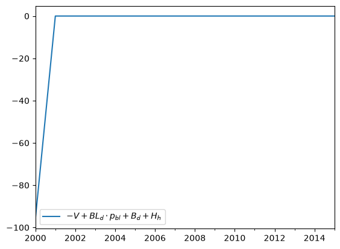
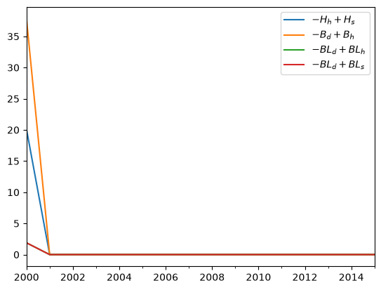

# Representations


<!-- WARNING: THIS FILE WAS AUTOGENERATED! DO NOT EDIT! -->

``` python
from nbdev.showdoc import show_doc
```

These are optional, but can be helpful if you’re going to do a lot of
manipulations or plotting based on the SFC matrices for your model.

For this page, we’ll work with Godley/Lavoie’s model LP as an example:

``` python
Variable.default_value = 0

Bcb = Variable('B_{cb}','Government bills held by the Central Bank')
Bd = Variable('B_d','Demand for government bills')
Bh = Variable('B_h','Government bills held by households')
Bs = Variable('B_s','Government bills supplied by government')
BLd = Variable('BL_d','Demand for government bonds')
BLh = Variable('BL_h','Government bonds held by households')
BLs = Variable('BL_s','Supply of government bonds')
CG = Variable('CG','Capital gains on bonds')
CGe = Variable('CG^e','Expected capital gains on bonds')
C = Variable('C','Consumption')
ERrbl = Variable('ERr_{bl}','Expected rate of return on bonds')
Hd = Variable('H_d','Demand for cash')
Hh = Variable('H_h','Cash held by households')
Hs = Variable('H_s','Cash supplied by the central bank')
Pbl = Variable('p_{bl}','Price of bonds')
Pble = Variable('p_{bl}^e','Expected price of bonds')
Rb = Variable('r_b','Interest rate on government bills')
Rbl = Variable('r_{bl}','Interest rate on government bonds')
T = Variable('T','Taxes')
V = Variable('V','Household wealth')
Ve = Variable('V^e','Expected household wealth')
Y = Variable('Y','Income = GDP')
YDr = Variable('YD_r','Regular disposable income of households')
YDre = Variable('YD_r^e','Expected regular disposable income of households')

Parameter.default_value = 0
alpha1 = Parameter('alpha_1', 'Propensity to consume out of income')
alpha2 = Parameter('alpha)2', 'Propensity to consume out of wealth')
chi = Parameter('chi', 'Weight of conviction in expected bond price')
lambda10 = Parameter('lambda_{10}', 'Parameter in asset demand function')
lambda12 = Parameter('lambda_{12}', 'Parameter in asset demand function')
lambda13 = Parameter('lambda_{13}', 'Parameter in asset demand function')
lambda14 = Parameter('lambda_{14}', 'Parameter in asset demand function')
lambda20 = Parameter('lambda_{20}', 'Parameter in asset demand function')
lambda22 = Parameter('lambda_{22}', 'Parameter in asset demand function')
lambda23 = Parameter('lambda_{23}', 'Parameter in asset demand function')
lambda24 = Parameter('lambda_{24}', 'Parameter in asset demand function')
lambda30 = Parameter('lambda_{30}', 'Parameter in asset demand function')
lambda32 = Parameter('lambda_{32}', 'Parameter in asset demand function')
lambda33 = Parameter('lambda_{33}', 'Parameter in asset demand function')
lambda34 = Parameter('lambda_{34}', 'Parameter in asset demand function')
theta = Parameter('theta', 'Tax rate')

G = Parameter('G', 'Government goods')
Rbar = Parameter('\\bar{r}_b', 'Exogenously set interest rate on govt bills')
Pblbar = Parameter('\\bar{P}_{bL}', 'Exogenously set price of bonds')

model = SFCmodel(
    [
        Y << C + G,                                  
        YDr << Y - T + Rb(-1)*Bh(-1) + BLh(-1),      
        T << theta *(Y + Rb(-1)*Bh(-1) + BLh(-1)),    
        d(V) << (YDr - C) + CG,                 
        CG << (Pbl - Pbl(-1))*BLh(-1),
        C << alpha1*YDre + alpha2*V(-1),
        Ve << V(-1) + (YDre - C) + CG,
        Hh << V - Bh - Pbl*BLh,
        Hd << Ve - Bd - Pbl*BLd,
        Bd << Ve*lambda20 + Ve*lambda22*Rb - Ve*lambda23*ERrbl - lambda24*YDre,
        BLd << (Ve*lambda30 - Ve*lambda32*Rb  + Ve*lambda33*ERrbl - lambda34*YDre)/Pbl,
        Bh << Bd,
        BLh << BLd,
        d(Bs) << (G + Rb(-1)*Bs(-1) + BLs(-1)) - (T + Rb(-1)*Bcb(-1)) - (BLs - BLs(-1))*Pbl,
        d(Hs) << Bcb - Bcb(-1),
        Bcb << Bs - Bh,
        BLs << BLh,
        ERrbl << Rbl + chi * (Pble - Pbl) / Pbl,
        Rbl << 1./Pbl,
        Pble << Pbl,
        CGe << chi * (Pble - Pbl)*BLh,
        YDre << YDr(-1),
        Rb << Rbar,
        Pbl << Pblbar,
    ],
    redundant_equation = Hs << Hh
)

model[:] = {
      alpha1: 0.8,
      alpha2: 0.2,
      chi: 0.1,
      lambda20: 0.44196,
      lambda22: 1.1,
      lambda23: 1,
      lambda24: 0.03,
      lambda30: 0.3997,
      lambda32: 1,
      lambda33: 1.1,
      lambda34: 0.03,
      theta: 0.1938
}
model[:] = {G: 20,
                 Rbar: 0.03,
                 Pblbar: 20}
model[:] = {V: 95.803,
                 Bh: 37.839,
                 Bs: 57.964,
                 Bcb: 57.964 - 37.839,
                 BLh: 1.892,
                 BLs: 1.892,
                 Hs: 20.125,
                 YDr: 95.803,
                 Rb: 0.03,
                 Pbl: 20}

model.solve(15, redundant_tol=1e-4);
```

      0%|          | 0/15 [00:00<?, ?it/s]

------------------------------------------------------------------------

<a
href="https://github.com/slevey087/SFCmodeler/blob/main/SFCmodeler/representations.py#L24"
target="_blank" style="float:right; font-size:smaller">source</a>

### Sector

``` python
def Sector(
    NW:Term | None=None, name:NoneType=None
):
```

*Represents an economic sector, such as Households or Firms.*

Create one
[`Sector`](https://slevey087.github.io/SFCmodeler/representations.html#sector)
for each column in your balance sheet and transactions flow matrices.

``` python
Production = Sector()
Government = Sector()
CB = Sector()
```

They don’t need any information, but you can optionally supply a Net
Worth variable if one explicitly exists in the model.

``` python
Households = Sector(NW=V)
```

------------------------------------------------------------------------

<a
href="https://github.com/slevey087/SFCmodeler/blob/main/SFCmodeler/representations.py#L38"
target="_blank" style="float:right; font-size:smaller">source</a>

### Asset

``` python
def Asset(
    supplies:dict[Sector | str, Variable]=None, demands:dict[Sector | str, Variable]=None,
    total_supply:Term | None=None, total_demand:Term | None=None, issuer:Sector | None=None,
    price:Term | sp.Expr | sp.Number | float=1, payout:Callable[[Variable], sp.Expr | Term | sp.Number] | None=None,
    name:NoneType=None
):
```

*Represent an asset, real or financial.*

The `supplies` and `demands` fields should be dictionaries where the
keys are
[`Sector`](https://slevey087.github.io/SFCmodeler/representations.html#sector)s
and the values are the `Variables` from your model that represent the
supply/demand for that asset from that sector. If it’s a financial
asset, the `issuer` should be the sector who the claim is against (the
liability or equity share), or `None` if it’s a real asset.

``` python
Money = Asset(
    issuer = CB,
    supplies = {
        Households:Hs
    },
    demands = {
        Households:Hh   
        # Note that this model has Hd which is the demand for money before the period, i.e. not identically eqal to Hs, so shouldn't be used here
    },
)
```

When there are multiple sectors holding the asset, use `"Total"` to
indicate this variable, as in the examples below.

Also, you can optionally provide a `payout` function. This function will
take in one of the relevant
[`Variable`](https://slevey087.github.io/SFCmodeler/term.html#variable)s
(such as `Bd` here), and should return an expression that indicates what
interest payments it makes.

``` python
Bills = Asset(
    issuer = Government,
    demands = {
        Households: Bd,
        CB: Bcb
    },
    supplies = {
        Households:Bh,
    },
    total_supply = Bs,
    payout = lambda var: Rb(-1) * var(-1)  # lagged, since bills pay based on previous period's holdings and rates
)
```

If an asset has a price, include that in the `price` field:

``` python
Bonds = Asset(
    issuer = Government,
    demands = {
        Households: BLd
    },
    supplies = {
        Households: BLh,
    },
    total_supply = BLs,
    price = Pbl,
    payout = lambda var: var(-1)  # bonds here pay $1 per unit bought last period
)
```

To quickly check if a variable or sector appears on the `supplies` or
`demands` for this asset, use `in`:

``` python
Bd in Bills
```

    True

``` python
Government in Bills
```

    False

------------------------------------------------------------------------

<a
href="https://github.com/slevey087/SFCmodeler/blob/main/SFCmodeler/representations.py#L74"
target="_blank" style="float:right; font-size:smaller">source</a>

### Asset.payout_to

``` python
def payout_to(
    sector:Sector
)->sp.Expr | Term | sp.Number:
```

*Returns an expression representing the payout to the specified sector,
from the `payout` function. (Checks supplies first, then demands.)*

``` python
Bills.payout_to(CB)
```

*B*<sub>*c**b*, −1</sub>*r*<sub>*b*, −1</sub>

And returns `0` if the sector doesn’t hold the asset:

``` python
Bonds.payout_to(CB)
```

0

------------------------------------------------------------------------

<a
href="https://github.com/slevey087/SFCmodeler/blob/main/SFCmodeler/representations.py#L82"
target="_blank" style="float:right; font-size:smaller">source</a>

### Asset.sector_zero_expression

``` python
def sector_zero_expression(
    sector:Sector | str
)->sp.Expr | None:
```

*Returns the supply minus demand for a sector, but only if there are
variables for both. Use ‘total’ to get total_supply - total_demand*

``` python
Bills.sector_zero_expression(Households)
```

−*B*<sub>*d*</sub> + *B*<sub>*h*</sub>

Use with
[`solve_for`](https://slevey087.github.io/SFCmodeler/misc.html#solve_for)
to generate equations:

``` python
solve_for(Bonds.sector_zero_expression(Households), BLh)
```

*B**L*<sub>*h*</sub> = *B**L*<sub>*d*</sub>

------------------------------------------------------------------------

<a
href="https://github.com/slevey087/SFCmodeler/blob/main/SFCmodeler/representations.py#L89"
target="_blank" style="float:right; font-size:smaller">source</a>

### Asset.sector_zero_expressions

``` python
def sector_zero_expressions()->list[sp.Expr | None]:
```

*Returns list of all sector zero expressions.*

``` python
Bonds.sector_zero_expressions()
```

\[−*B**L*<sub>*d*</sub> + *B**L*<sub>*h*</sub>,  − *B**L*<sub>*d*</sub> + *B**L*<sub>*s*</sub>\]

------------------------------------------------------------------------

<a
href="https://github.com/slevey087/SFCmodeler/blob/main/SFCmodeler/representations.py#L95"
target="_blank" style="float:right; font-size:smaller">source</a>

### Asset.market_zero_expression

``` python
def market_zero_expression(
    demand_or_supply:str='supply'
)->sp.Expr | None:
```

*If demand_or_supply == ‘supply’, returns total_supply minus supply for
each sector. If demand_or_supply == ‘demand’ returns total_demand minus
demand for each sector. Uses opposite term if none is available for that
sector.*

``` python
Bills.market_zero_expression('supply')
```

−*B*<sub>*h*</sub> − *B*<sub>*c**b*</sub> + *B*<sub>*s*</sub>

Use with
[`solve_for`](https://slevey087.github.io/SFCmodeler/misc.html#solve_for)
to create equations:

``` python
solve_for(Bills.market_zero_expression(), Bcb)
```

*B*<sub>*c**b*</sub> = −*B*<sub>*h*</sub> + *B*<sub>*s*</sub>

------------------------------------------------------------------------

<a
href="https://github.com/slevey087/SFCmodeler/blob/main/SFCmodeler/representations.py#L106"
target="_blank" style="float:right; font-size:smaller">source</a>

### BSmatrix

``` python
def BSmatrix(
    sectors:list[Sector], assets:list[Asset]
):
```

*Representation of Balance Sheet matrix, bringing Sectors and Assets
together.*

``` python
bs = BSmatrix(
    sectors = [Households, Production, Government, CB],
    assets = [Money, Bills, Bonds]
)
```

------------------------------------------------------------------------

<a
href="https://github.com/slevey087/SFCmodeler/blob/main/SFCmodeler/representations.py#L112"
target="_blank" style="float:right; font-size:smaller">source</a>

### BSmatrix.assets

``` python
def assets(
    sector:Sector
)->list[Variable]:
```

*Returns a list of the assets for the specified sector (looks in demands
first, then supplies).*

``` python
bs.assets(Households)
```

\[*H*<sub>*h*</sub>, *B*<sub>*d*</sub>, *B**L*<sub>*d*</sub>\]

------------------------------------------------------------------------

<a
href="https://github.com/slevey087/SFCmodeler/blob/main/SFCmodeler/representations.py#L116"
target="_blank" style="float:right; font-size:smaller">source</a>

### BSmatrix.asset_values

``` python
def asset_values(
    sector:Sector
)->list[sp.Expr | Variable]:
```

*Returns a list of the values of the assets (asset times price) for the
specified sector. (Looks in demand first, then supplies.)*

``` python
bs.asset_values(Households)
```

\[*H*<sub>*h*</sub>, *B*<sub>*d*</sub>, *B**L*<sub>*d*</sub>*p*<sub>*b**l*</sub>\]

Use `sum` to quickly get the asset side of a sector’s balance sheet:

``` python
sum(bs.asset_values(Households))
```

*B**L*<sub>*d*</sub>*p*<sub>*b**l*</sub> + *B*<sub>*d*</sub> + *H*<sub>*h*</sub>

------------------------------------------------------------------------

<a
href="https://github.com/slevey087/SFCmodeler/blob/main/SFCmodeler/representations.py#L120"
target="_blank" style="float:right; font-size:smaller">source</a>

### BSmatrix.liabilities

``` python
def liabilities(
    sector:Sector
)->list[sp.Expr | Variable]:
```

*Returns list of liabilities for the specified sector. First uses
‘Total’ supply, but adds for each sector if that’s not present.*

``` python
bs.liabilities(Government)
```

\[*B*<sub>*s*</sub>, *B**L*<sub>*s*</sub>\]

------------------------------------------------------------------------

<a
href="https://github.com/slevey087/SFCmodeler/blob/main/SFCmodeler/representations.py#L124"
target="_blank" style="float:right; font-size:smaller">source</a>

### BSmatrix.liability_values

``` python
def liability_values(
    sector:Sector
)->list[sp.Expr | Variable]:
```

*Returns list of the values of the liabilities (asset times price) for
the specified sector.*

``` python
bs.liability_values(Government)
```

\[*B*<sub>*s*</sub>, *B**L*<sub>*s*</sub>*p*<sub>*b**l*</sub>\]

Use `sum` to quickly get the liability side of the balance sheet:

``` python
sum(bs.liability_values(Government))
```

*B**L*<sub>*s*</sub>*p*<sub>*b**l*</sub> + *B*<sub>*s*</sub>

------------------------------------------------------------------------

<a
href="https://github.com/slevey087/SFCmodeler/blob/main/SFCmodeler/representations.py#L129"
target="_blank" style="float:right; font-size:smaller">source</a>

### BSmatrix.net_worth

``` python
def net_worth(
    sector:Sector
)->Variable | sp.Expr:
```

*Returns the net worth variable for the sector if there is one,
otherwise sums assets minus liabilities.*

``` python
bs.net_worth(Households)
```

*V*

``` python
bs.net_worth(CB)
```

−*H*<sub>*s*</sub> + *B*<sub>*c**b*</sub>

------------------------------------------------------------------------

<a
href="https://github.com/slevey087/SFCmodeler/blob/main/SFCmodeler/representations.py#L133"
target="_blank" style="float:right; font-size:smaller">source</a>

### BSmatrix.sector_zero_expression

``` python
def sector_zero_expression(
    sector:Sector
)->sp.Expr:
```

*Returns sum of assets minus sum of liabilities minus net worth for a
sector. (Note: will return zero if there’s no NW variable defined on the
sector.)*

``` python
bs.sector_zero_expression(Households)
```

−*V* + *B**L*<sub>*d*</sub>*p*<sub>*b**l*</sub> + *B*<sub>*d*</sub> + *H*<sub>*h*</sub>

This can be useful to use as a key to
[`ModelResults`](https://slevey087.github.io/SFCmodeler/modelresults.html#modelresults),
to check that you get zero, i.e. that the balance sheet balances in your
simulation results.

``` python
model.data[bs.sector_zero_expression(Households)].plot()
```



Or use with
[`solve_for`](https://slevey087.github.io/SFCmodeler/misc.html#solve_for)
to generate equations:

``` python
solve_for(bs.sector_zero_expression(Households), Hh)
```

*H*<sub>*h*</sub> = −*B*<sub>*d*</sub> − *B**L*<sub>*d*</sub>*p*<sub>*b**l*</sub> + *V*

But don’t forget that you will get identically zero if there’s no `NW`
[`Variable`](https://slevey087.github.io/SFCmodeler/term.html#variable)
defined in the
[`Sector`](https://slevey087.github.io/SFCmodeler/representations.html#sector):

``` python
bs.sector_zero_expression(Government)
```

0

------------------------------------------------------------------------

<a
href="https://github.com/slevey087/SFCmodeler/blob/main/SFCmodeler/representations.py#L137"
target="_blank" style="float:right; font-size:smaller">source</a>

### BSmatrix.sector_zero_expressions

``` python
def sector_zero_expressions()->list[sp.Expr]:
```

*Returns a list of zero expressions for all sectors, but only ones with
NW variables defined on the sector.*

``` python
bs.sector_zero_expressions()
```

\[−*V* + *B**L*<sub>*d*</sub>*p*<sub>*b**l*</sub> + *B*<sub>*d*</sub> + *H*<sub>*h*</sub>\]

Feed this as a key to
[`ModelResults`](https://slevey087.github.io/SFCmodeler/modelresults.html#modelresults)
in order to check balance sheet identities for all sectors at once.

------------------------------------------------------------------------

<a
href="https://github.com/slevey087/SFCmodeler/blob/main/SFCmodeler/representations.py#L142"
target="_blank" style="float:right; font-size:smaller">source</a>

### BSmatrix.asset_zero_expressions

``` python
def asset_zero_expressions()->list[sp.Expr]:
```

*Returns asset supply minus demand for all assets in the balance sheet.*

``` python
bs.asset_zero_expressions()
```

\[−*H*<sub>*h*</sub> + *H*<sub>*s*</sub>,  − *B*<sub>*d*</sub> + *B*<sub>*h*</sub>,  − *B**L*<sub>*d*</sub> + *B**L*<sub>*h*</sub>,  − *B**L*<sub>*d*</sub> + *B**L*<sub>*s*</sub>\]

Use this as a key to
[`ModelResults`](https://slevey087.github.io/SFCmodeler/modelresults.html#modelresults)
to check asset demand/supply consistency for all assets at once in your
simulation results:

``` python
model.data[bs.asset_zero_expressions()].plot()
```



------------------------------------------------------------------------

<a
href="https://github.com/slevey087/SFCmodeler/blob/main/SFCmodeler/representations.py#L149"
target="_blank" style="float:right; font-size:smaller">source</a>

### Transaction

``` python
def Transaction(
    entries:dict[Sector, sp.Expr | Term]
):
```

*Represents a row in a Transactions Flow matrix.*

Create a
[`Transaction`](https://slevey087.github.io/SFCmodeler/representations.html#transaction)
by supplying a dictionary where the keys are
[`Sector`](https://slevey087.github.io/SFCmodeler/representations.html#sector)s
and the values are the expressions for that sector in the transaction:

``` python
Consumption = Transaction({Households:-C, Production:C})
GovernmentExpenditures = Transaction({Government:-G,Production:G})
Income = Transaction({Production:-Y, Households:Y})
CBProfits = Transaction({CB:-Rb(-1)*Bcb(-1), Government:Rb(-1)*Bcb(-1)})
Taxes = Transaction({Households:-T, Government:T})
```

Note that we’ve skipped transactions for interest payments, changes in
assets, and capital gains – the matrices below will build these for us.
But, let’s create one just for illustrative purposes:

``` python
InterestOnBills = Transaction({Households:Rb(-1)*Bh(-1),Government:-Rb(-1)*Bs(-1),CB:Rb(-1)*Bcb(-1)})
```

Quickly fetch an expression for a sector by indexing:

``` python
CBProfits[Government]
```

*B*<sub>*c**b*, −1</sub>*r*<sub>*b*, −1</sub>

Including uninvolved sectors:

``` python
Consumption[CB]
```

0

------------------------------------------------------------------------

<a
href="https://github.com/slevey087/SFCmodeler/blob/main/SFCmodeler/representations.py#L166"
target="_blank" style="float:right; font-size:smaller">source</a>

### Transaction.zero_expression

``` python
def zero_expression()->sp.Expr:
```

*Sums across the transaction (horizontal sum), which should equal zero
by identity.*

``` python
Consumption.zero_expression()
```

−*C* + *C*

For some transactions this is trivial, but for others it is more useful,
e.g.

``` python
InterestOnBills.zero_expression()
```

*B*<sub>*h*, −1</sub>*r*<sub>*b*, −1</sub> − *B*<sub>*s*, −1</sub>*r*<sub>*b*, −1</sub> + *B*<sub>*c**b*, −1</sub>*r*<sub>*b*, −1</sub>

Use this as a key with
[`ModelResults`](https://slevey087.github.io/SFCmodeler/modelresults.html#modelresults)
to check for horizontal consistency

``` python
model.data[InterestOnBills.zero_expression()]
```

<table>
<colgroup>
<col style="width: 6%" />
<col style="width: 93%" />
</colgroup>
<thead>
<tr>
<th style="text-align: left;"></th>
<th style="text-align: right;"><span
class="math inline"><em>B</em><sub><em>h</em>, −1</sub> ⋅ <em>r</em><sub><em>b</em>, −1</sub> − <em>B</em><sub><em>s</em>, −1</sub> ⋅ <em>r</em><sub><em>b</em>, −1</sub> + <em>B</em><sub><em>c</em><em>b</em>, −1</sub> ⋅ <em>r</em><sub><em>b</em>, −1</sub></span></th>
</tr>
</thead>
<tbody>
<tr>
<td style="text-align: left;">2000</td>
<td style="text-align: right;">0</td>
</tr>
<tr>
<td style="text-align: left;">2001</td>
<td style="text-align: right;">2.22045e-16</td>
</tr>
<tr>
<td style="text-align: left;">2002</td>
<td style="text-align: right;">-2.22045e-16</td>
</tr>
<tr>
<td style="text-align: left;">2003</td>
<td style="text-align: right;">0</td>
</tr>
<tr>
<td style="text-align: left;">2004</td>
<td style="text-align: right;">0</td>
</tr>
<tr>
<td style="text-align: left;">2005</td>
<td style="text-align: right;">0</td>
</tr>
<tr>
<td style="text-align: left;">2006</td>
<td style="text-align: right;">0</td>
</tr>
<tr>
<td style="text-align: left;">2007</td>
<td style="text-align: right;">-2.22045e-16</td>
</tr>
<tr>
<td style="text-align: left;">2008</td>
<td style="text-align: right;">-2.22045e-16</td>
</tr>
<tr>
<td style="text-align: left;">2009</td>
<td style="text-align: right;">2.22045e-16</td>
</tr>
<tr>
<td style="text-align: left;">2010</td>
<td style="text-align: right;">4.44089e-16</td>
</tr>
<tr>
<td style="text-align: left;">2011</td>
<td style="text-align: right;">-2.22045e-16</td>
</tr>
<tr>
<td style="text-align: left;">2012</td>
<td style="text-align: right;">0</td>
</tr>
<tr>
<td style="text-align: left;">2013</td>
<td style="text-align: right;">0</td>
</tr>
<tr>
<td style="text-align: left;">2014</td>
<td style="text-align: right;">0</td>
</tr>
<tr>
<td style="text-align: left;">2015</td>
<td style="text-align: right;">0</td>
</tr>
</tbody>
</table>

or with
[`solve_for`](https://slevey087.github.io/SFCmodeler/misc.html#solve_for)
to generate equations:

``` python
solve_for(InterestOnBills.zero_expression(),Bs(-1))
```

*B*<sub>*s*, −1</sub> = *B*<sub>*h*, −1</sub> + *B*<sub>*c**b*, −1</sub>

------------------------------------------------------------------------

<a
href="https://github.com/slevey087/SFCmodeler/blob/main/SFCmodeler/representations.py#L172"
target="_blank" style="float:right; font-size:smaller">source</a>

### TFmatrix

``` python
def TFmatrix(
    sectors:list[Sector], transactions:list[Transaction], assets:list[Asset] | None=None
):
```

*Class representing the Transactions Flow matrix.*

``` python
tf = TFmatrix(
    sectors = [Households, Production, Government, CB],
    transactions = [Consumption, GovernmentExpenditures, Income, CBProfits, Taxes],
    assets = [Money, Bills, Bonds]
)
```

`assets` is optional, but if you put it in, the matrix will generate
additional transactions automatically for interest payments and changes
in stocks. Then you can use the matrix to generate expressions or
equations as follows.

------------------------------------------------------------------------

<a
href="https://github.com/slevey087/SFCmodeler/blob/main/SFCmodeler/representations.py#L204"
target="_blank" style="float:right; font-size:smaller">source</a>

### TFmatrix.sector_zero_expression

``` python
def sector_zero_expression(
    sector:Sector
)->sp.Expr:
```

*Returns the sume of a column (income - spending - change in holdings)
for specified sector.*

``` python
tf.sector_zero_expression(Government)
```

−*G* − *B**L*<sub>*s*, −1</sub> − *B*<sub>*s*, −1</sub> + (−*B**L*<sub>*s*, −1</sub> + *B**L*<sub>*s*</sub>)*p*<sub>*b**l*</sub> + *B*<sub>*c**b*, −1</sub>*r*<sub>*b*, −1</sub> − *B*<sub>*s*, −1</sub>*r*<sub>*b*, −1</sub> + *B*<sub>*s*</sub> + *T*

Use this with
[`solve_for`](https://slevey087.github.io/SFCmodeler/misc.html#solve_for)
to generate sector transaction equations:

``` python
solve_for(tf.sector_zero_expression(Government),Bs)
```

*B*<sub>*s*</sub> = −*T* + *B**L*<sub>*s*, −1</sub>*p*<sub>*b**l*</sub> + *B*<sub>*s*, −1</sub>*r*<sub>*b*, −1</sub> − *B**L*<sub>*s*</sub>*p*<sub>*b**l*</sub> − *B*<sub>*c**b*, −1</sub>*r*<sub>*b*, −1</sub> + *G* + *B**L*<sub>*s*, −1</sub> + *B*<sub>*s*, −1</sub>

------------------------------------------------------------------------

<a
href="https://github.com/slevey087/SFCmodeler/blob/main/SFCmodeler/representations.py#L208"
target="_blank" style="float:right; font-size:smaller">source</a>

### TFmatrix.sector_zero_expressions

``` python
def sector_zero_expressions()->list[sp.Expr]:
```

*Returns the sume of a column (income - spending - change in holdings)
for all sectors.*

``` python
tf.sector_zero_expressions()
```

\[−*B*<sub>*d*</sub> − *C* − *H*<sub>*h*</sub> − *T* + (−*B**L*<sub>*d*</sub> + *B**L*<sub>*d*, −1</sub>)*p*<sub>*b**l*</sub> + *B*<sub>*h*, −1</sub>*r*<sub>*b*, −1</sub> + *B**L*<sub>*h*, −1</sub> + *B*<sub>*d*, −1</sub> + *H*<sub>*h*, −1</sub> + *Y*,  − *Y* + *G* + *C*,  − *G* − *B**L*<sub>*s*, −1</sub> − *B*<sub>*s*, −1</sub> + (−*B**L*<sub>*s*, −1</sub> + *B**L*<sub>*s*</sub>)*p*<sub>*b**l*</sub> + *B*<sub>*c**b*, −1</sub>*r*<sub>*b*, −1</sub> − *B*<sub>*s*, −1</sub>*r*<sub>*b*, −1</sub> + *B*<sub>*s*</sub> + *T*,  − *B*<sub>*c**b*</sub> − *H*<sub>*s*, −1</sub> + *B*<sub>*c**b*, −1</sub> + *H*<sub>*s*</sub>\]

------------------------------------------------------------------------

<a
href="https://github.com/slevey087/SFCmodeler/blob/main/SFCmodeler/representations.py#L212"
target="_blank" style="float:right; font-size:smaller">source</a>

### TFmatrix.transaction_zero_expressions

``` python
def transaction_zero_expressions():
```

*Return all transaction zero expressions (row sums).*

``` python
tf.transaction_zero_expressions()
```

\[−*C* + *C*,  − *G* + *G*,  − *Y* + *Y*,  − *B*<sub>*c**b*, −1</sub>*r*<sub>*b*, −1</sub> + *B*<sub>*c**b*, −1</sub>*r*<sub>*b*, −1</sub>,  − *T* + *T*, 0, *B*<sub>*h*, −1</sub>*r*<sub>*b*, −1</sub> + *B*<sub>*c**b*, −1</sub>*r*<sub>*b*, −1</sub> − *B*<sub>*s*, −1</sub>*r*<sub>*b*, −1</sub>, *B**L*<sub>*h*, −1</sub> − *B**L*<sub>*s*, −1</sub>, (−*H*<sub>*h*</sub> + *H*<sub>*h*, −1</sub>) + (−*H*<sub>*s*, −1</sub> + *H*<sub>*s*</sub>), (−*B*<sub>*d*</sub> + *B*<sub>*d*, −1</sub>) − (−*B*<sub>*c**b*, −1</sub> + *B*<sub>*c**b*</sub>) + (−*B*<sub>*s*, −1</sub> + *B*<sub>*s*</sub>), (−*B**L*<sub>*d*</sub> + *B**L*<sub>*d*, −1</sub>)*p*<sub>*b**l*</sub> + (−*B**L*<sub>*s*, −1</sub> + *B**L*<sub>*s*</sub>)*p*<sub>*b**l*</sub>\]

------------------------------------------------------------------------

<a
href="https://github.com/slevey087/SFCmodeler/blob/main/SFCmodeler/representations.py#L200"
target="_blank" style="float:right; font-size:smaller">source</a>

### TFmatrix.change_in_sector_holdings

``` python
def change_in_sector_holdings(
    sector
):
```

*Sums the change in asset holding entries for a particular sector.*

``` python
tf.change_in_sector_holdings(Government)
```

−*B*<sub>*s*, −1</sub> + (−*B**L*<sub>*s*, −1</sub> + *B**L*<sub>*s*</sub>)*p*<sub>*b**l*</sub> + *B*<sub>*s*</sub>

------------------------------------------------------------------------

<a
href="https://github.com/slevey087/SFCmodeler/blob/main/SFCmodeler/representations.py#L217"
target="_blank" style="float:right; font-size:smaller">source</a>

### RVmatrix

``` python
def RVmatrix(
    sectors:list[Sector], assets:list[Asset]
):
```

Create a revaluation matrix by specifying the assets and sectors it
should contain:

``` python
rv = RVmatrix(
    sectors = [Households, Production, Government, CB],
    assets = [Money, Bills, Bonds]
)
```

The class will automatically generate expressions for every capital gain
term, which you can access like this:

``` python
rv[(Bonds, Households)]
```

(−*p*<sub>*b**l*, −1</sub> + *p*<sub>*b**l*</sub>)*B**L*<sub>*d*, −1</sub>

Including ones which don’t exist:

``` python
rv[(Production, Money)]
```

0

------------------------------------------------------------------------

<a
href="https://github.com/slevey087/SFCmodeler/blob/main/SFCmodeler/representations.py#L240"
target="_blank" style="float:right; font-size:smaller">source</a>

### RVmatrix.asset_expression

``` python
def asset_expression(
    asset:Asset
)->sp.Expr:
```

*Sums all the capital gains terms for a single asset (row sum).*

``` python
rv.asset_expression(Bonds)
```

(−*p*<sub>*b**l*, −1</sub> + *p*<sub>*b**l*</sub>)*B**L*<sub>*d*, −1</sub> + (−*p*<sub>*b**l*, −1</sub> + *p*<sub>*b**l*</sub>)*B**L*<sub>*s*, −1</sub>

------------------------------------------------------------------------

<a
href="https://github.com/slevey087/SFCmodeler/blob/main/SFCmodeler/representations.py#L236"
target="_blank" style="float:right; font-size:smaller">source</a>

### RVmatrix.sector_expression

``` python
def sector_expression(
    sector:Sector
)->sp.Expr:
```

*Sums all the capital gains terms for a single sector (column sum).*

``` python
rv.sector_expression(Households)
```

(−*p*<sub>*b**l*, −1</sub> + *p*<sub>*b**l*</sub>)*B**L*<sub>*d*, −1</sub>

This is the last item needed to generate full change-in-wealth
equations:

------------------------------------------------------------------------

<a
href="https://github.com/slevey087/SFCmodeler/blob/main/SFCmodeler/representations.py#L34"
target="_blank" style="float:right; font-size:smaller">source</a>

### Sector.wealth_zero_expression

``` python
def wealth_zero_expression(
    tf:TFmatrix, rv:RVmatrix
)->sp.Expr:
```

``` python
Households.wealth_zero_expression(tf, rv)
```

−*B*<sub>*d*</sub> − *H*<sub>*h*</sub> − *V*<sub>−1</sub> + (−*B**L*<sub>*d*</sub> + *B**L*<sub>*d*, −1</sub>)*p*<sub>*b**l*</sub> − (−*p*<sub>*b**l*, −1</sub> + *p*<sub>*b**l*</sub>)*B**L*<sub>*d*, −1</sub> + *B*<sub>*d*, −1</sub> + *H*<sub>*h*, −1</sub> + *V*

------------------------------------------------------------------------

<a
href="https://github.com/slevey087/SFCmodeler/blob/main/SFCmodeler/representations.py#L244"
target="_blank" style="float:right; font-size:smaller">source</a>

### RVmatrix.sector_zero_expressions

``` python
def sector_zero_expressions(
    tf:TFmatrix
)->list[sp.Expr]:
```

*Returns list of all wealth_zero_expressions for each sector with a NW
term.*

``` python
rv.sector_zero_expressions(tf)
```

\[−*B*<sub>*d*</sub> − *H*<sub>*h*</sub> − *V*<sub>−1</sub> + (−*B**L*<sub>*d*</sub> + *B**L*<sub>*d*, −1</sub>)*p*<sub>*b**l*</sub> − (−*p*<sub>*b**l*, −1</sub> + *p*<sub>*b**l*</sub>)*B**L*<sub>*d*, −1</sub> + *B*<sub>*d*, −1</sub> + *H*<sub>*h*, −1</sub> + *V*\]
